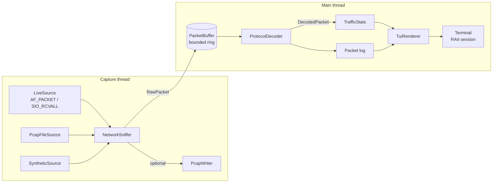

<div align="center">

# tui-packet-inspector

**A zero-dependency terminal packet inspector for TCP, UDP and Modbus — written in modern C++17.**

Live throughput graphs, protocol breakdowns, top talkers, Modbus transaction latency and a
Wireshark-style packet log, right inside your terminal. No libpcap, no ncurses, no Boost.


[English](#english) · [Türkçe](#türkçe)

</div>

```text
 ◆ tui-packet-inspector v1.0.0   source demo (virtual stream, ~400 pkt/s)                  ● LIVE   up 00:00:06
╭─ Throughput ────────────────────────────────────────────────────╮╭─ Protocols ───────────────────────────────╮
│ 560 pkt/s   101.0 KB/s   peak 1.6k pkt/s    4,728 pkts 744.9 KB ││ Modbus ███████░░░░░░░░░░   39.7%    1,878 │
│  2.0k┤                                                          ││ TCP    ████░░░░░░░░░░░░░   25.7%    1,215 │
│      │    ▃      ▃                                              ││ UDP    ████░░░░░░░░░░░░░   24.5%    1,159 │
│      │▄ █ █  ▆▆▄▆█ ▆                                            ││ ICMP   █░░░░░░░░░░░░░░░░    6.7%      319 │
│  1.0k┤█▇█▇██████████▆                                           ││ ARP    █░░░░░░░░░░░░░░░░    3.3%      157 │
│      │███████████████▂   ▁        ▁   ▁▁ ▂▃▃▃ ▃▆▁▂▂ ▃▇ ▁▁▁▁▃▁▂  ││ Other  ░░░░░░░░░░░░░░░░░    0.0%        0 │
│      │████████████████▇█▅█▆█▆▅▇▂▄██▅▄███▇█████████████▆████████ ││                                           │
│     0┤█████████████████████████████████████████████████████████ ││ malformed 0  syn 19  rst 13               │
╰─────────────────────────────────────────────────────────────────╯╰───────────────────────────────────────────╯
╭─ Top talkers ────────────────────────────╮╭─ Modbus / ICS ───────────────────────────────────────────────────╮
│ Source                Packets      Bytes ││ req 939  resp 939  exc 31 (3.3%)                                 │
│ 140.82.121.4              189   105.1 KB ││ rtt avg 18.6 ms  max 127.5 ms  last 17.1 ms                      │
│ 151.101.1.69              167    90.8 KB ││ FC03 Read Holding Registers               ███████░░░░░░░   46.4% │
│ 104.16.132.229            178    89.9 KB ││ FC04 Read Input Registers                 ██░░░░░░░░░░░░   16.8% │
│ 93.184.216.34             165    87.2 KB ││ last exc: Illegal Function (FC06, unit 2)                        │
╰──────────────────────────────────────────╯╰──────────────────────────────────────────────────────────────────╯
╭─ Packet log [All] 4,728 entries ───────────────────────────────────────────────────────────────── following ─╮
│ No.     Time         Proto   Source              Destination         Len Info                                │
│ 4719    11:24:49.948 UDP     10.0.0.25:62005   → 1.1.1.1:53           70 DNS  62005 -> 53 len=28             │
│ 4720    11:24:49.948 TCP     151.101.1.69:80   → 10.0.0.24:54247     874 HTTP  80 -> 54247 [PSH,ACK] seq=27… │
│ 4721    11:24:49.948 UDP     10.0.0.22:56509   → 1.1.1.1:53           77 DNS  56509 -> 53 len=35             │
│ 4722    11:24:49.948 ICMP    10.0.0.25         → 1.1.1.1              74 Echo request (code 0)               │
│ 4723    11:24:49.948 ICMP    10.0.0.22         → 1.1.1.1              74 Echo request (code 0)               │
│ 4724    11:24:49.948 TCP     104.16.132.229:4… → 10.0.0.27:59809     839 HTTPS  443 -> 59809 [PSH,ACK] seq=… │
│ 4725    11:24:49.948 ICMP    10.0.0.28         → 1.1.1.1              74 Echo request (code 0)               │
│ 4726    11:24:49.948 TCP     10.0.0.23:49734   → 140.82.121.4:443    618 HTTPS  49734 -> 443 [PSH,ACK] seq=… │
│ 4727    11:24:49.948 ARP     10.0.0.25         → 10.0.0.36            60 Who has 10.0.0.36? Tell 10.0.0.25   │
│ 4728    11:24:49.964 UDP     1.1.1.1:53        → 10.0.0.23:56120      93 DNS  53 -> 56120 len=51             │
╰──────────────────────────────────────────────────────────────────────────────────────────────────────────────╯
  q  Quit   p  Pause   f  Filter:All   ↑↓  Scroll   End  Follow   c  Clear   h  Help
```

<sub>Text snapshot of the built-in demo stream. In a real terminal every panel is colored (256-color ANSI).</sub>

---

## English

### Why this project?

Most packet tools are either heavyweight GUIs (Wireshark) or firehose CLIs (tcpdump). `tui-packet-inspector`
sits in between: a **single small binary** that gives you a live, glanceable dashboard of what is happening on
the wire — with first-class support for **Modbus**, the protocol that still runs most of the world's PLCs.

- **Zero heavy dependencies** – only the C++17 standard library and the OS socket API. No libpcap, no ncurses.
- **Runs in one second** – the built-in virtual traffic stream needs no root/admin, so `./tui-packet-inspector`
  instantly shows a realistic office + OT network (HTTP/TLS, DNS, NTP, ARP, ICMP, IPv6 mDNS, Modbus/TCP, Modbus RTU).
- **Three capture sources** – live raw sockets (Linux `AF_PACKET`, Windows `SIO_RCVALL`), classic `.pcap` files
  (with optional real-time replay) and the virtual stream.
- **Record anything** – `-w out.pcap` mirrors every captured packet to a Wireshark-compatible file.
- **Industrial insight** – Modbus request/response pairing with round-trip latency, exception tracking,
  function-code histogram, pipelined-ADU detection, RTU CRC validation and alerts for non-Modbus payloads on port 502.
- **Script friendly** – `--plain` (automatic when piped) prints one decoded line per packet, so `grep`/`awk` just work.
- **Safe by construction** – RAII everywhere, no `new`/`delete`, bounds-checked parsing, bounded memory,
  a fuzz test and an ASan/UBSan CI job.

### Quick start

```bash
# Build (any C++17 compiler: GCC ≥ 8, Clang ≥ 7, MSVC 2019+)
cmake -S . -B build -DCMAKE_BUILD_TYPE=Release
cmake --build build --parallel

# Run the demo dashboard (no privileges required)
./build/tui-packet-inspector

# Run the test suite
ctest --test-dir build --output-on-failure
```

On Windows with Visual Studio the binary lands in `build\Release\tui-packet-inspector.exe`.
With MinGW/Ninja it is `build\tui-packet-inspector.exe` (statically linked, runs anywhere).

### Usage

```text
tui-packet-inspector [source] [options]

Sources (default: --demo)
  -d, --demo               virtual traffic stream incl. Modbus/TCP + RTU (no privileges)
  -i, --iface <name>       live capture  (Linux: eth0 | Windows: local IPv4 address)
  -r, --read <file.pcap>   read a classic libpcap file
      --realtime           replay a pcap file with its original timing

Options
  -w, --write <file.pcap>  record every captured packet to a pcap file
  -m, --modbus-port <port> extra TCP/UDP port to decode as Modbus (repeatable)
      --rate <pps>         demo stream average rate (default 300)
      --seed <n>           make the demo stream reproducible
  -p, --plain              no dashboard: print one line per packet (auto when piped)
  -n, --count <N>          plain mode: stop after N packets
      --fps <n>            dashboard refresh rate, 1-60 (default 12)
      --no-color           monochrome output (also honors NO_COLOR)
      --ascii              ASCII-only glyphs for limited terminals/fonts
```

Typical sessions:

```bash
sudo ./tui-packet-inspector -i eth0 -w capture.pcap          # live Linux capture + recording
./tui-packet-inspector -i 192.168.1.20                       # Windows (elevated prompt)
./tui-packet-inspector -r plant.pcap --realtime -m 5020      # replay, Modbus also on port 5020
./tui-packet-inspector -r plant.pcap --plain | grep EXCEPTION
```

Plain-mode output:

```text
2       11:13:17.831213  Modbus 192.168.1.60:50211       -> 192.168.1.10:502            66  Read Holding Registers req addr=37 qty=11 (unit 2, tid 1)
10      11:13:17.832376  Modbus 192.168.1.60:40502       -> 192.168.1.80:502            60  Write Multiple Registers req addr=124 qty=2 (unit 10, RTU crc ok)
22      11:13:17.834237  ARP    10.0.0.22                -> 10.0.0.5                    60  Who has 10.0.0.5? Tell 10.0.0.22
25      11:13:17.834867  Modbus 192.168.1.10:502         -> 192.168.1.50:49712          66  Read Discrete Inputs resp bytes=3 (unit 3, tid 5)
```

#### Keyboard shortcuts

| Key | Action |
| --- | --- |
| `q` / `Esc` / `Ctrl+C` | Quit (the terminal is always restored) |
| `p` / `Space` | Pause / resume the packet log (statistics keep updating) |
| `f` | Cycle the log filter: All → TCP → UDP → Modbus → Other |
| `↑` `↓` / `k` `j` | Scroll one line |
| `PgUp` / `PgDn` | Scroll one page |
| `Home` / `End` (`g` / `G`) | Jump to the oldest entry / follow the newest |
| `c` | Clear statistics and log |
| `h` / `?` | Toggle the help overlay |

#### Live capture privileges

| Platform | Mechanism | Requirement |
| --- | --- | --- |
| Linux | `AF_PACKET` raw socket, full Ethernet frames | root, or `sudo setcap cap_net_raw+ep ./tui-packet-inspector` |
| Windows | Raw IP socket + `SIO_RCVALL` (promiscuous) | Elevated (Administrator) terminal; pass a local IPv4 address |
| macOS | Not yet (BPF back-end on the roadmap) | Use `--read` or `--demo` |

### Protocol coverage

| Layer | Decoded fields |
| --- | --- |
| Ethernet II | MAC addresses, EtherType, 802.1Q / 802.1ad VLAN tags |
| ARP | Request / reply, sender & target addresses |
| IPv4 | Header length, TTL, total length, fragments, **header checksum validation** |
| IPv6 | Addresses (RFC 5952 formatting), hop limit, extension-header chain, fragments |
| ICMP / ICMPv6 | Type & code with readable names |
| TCP | Ports, seq/ack, flags, window, options length, payload size, service hint by port |
| UDP | Ports, length validation, payload size, service hint by port |
| **Modbus/TCP** | MBAP (transaction, protocol, length, unit), function code, address, quantity, value, byte count, **exceptions**, pipelined ADUs |
| **Modbus RTU** | Slave address, PDU, **CRC-16 validation** — e.g. RTU tunnelled over UDP by serial gateways |

Modbus is detected on port 502 by default; add more with `-m <port>`. Payloads on a Modbus port that are *not*
valid Modbus are flagged as malformed — a useful signal on an OT network.

### Architecture



| Module | Responsibility |
| --- | --- |
| `NetworkSniffer` | Owns a `CaptureSource` and pumps packets into the ring buffer on a background `std::thread`, joined in the destructor. Also hosts the platform raw-socket back-ends. |
| `PacketBuffer` | Mutex + condition-variable ring buffer. When full it overwrites the *oldest* packet and counts the drop, so capture never blocks. |
| `PcapFile` / `SyntheticSource` | pcap reader/writer (both byte orders, µs/ns) and the virtual traffic generator with real checksums. |
| `ProtocolDecoder` | Stateless parser: Ethernet → ARP / IPv4 / IPv6 → ICMP / TCP / UDP → Modbus/TCP / RTU. Never throws on bad input. |
| `TrafficStats` | Rate sampling, protocol counters, top talkers, Modbus transaction matching. All containers are bounded. |
| `TuiRenderer` | Composes each frame on an off-screen cell canvas and flushes it with a single write. |
| `Terminal` | RAII session: raw input, alternate screen, hidden cursor, UTF-8/VT mode on Windows — all restored on exit. |

### Design decisions

- **No ncurses, no libpcap.** ANSI escape sequences are universal today (including Windows 10+ consoles), and raw
  sockets are enough for a live view. Fewer dependencies means the project builds anywhere with just CMake.
- **RAII for every resource.** Sockets, file descriptors, Winsock, the capture thread, terminal modes and pcap files
  are all owned by objects whose destructors clean up — even when an exception unwinds the stack. The codebase has
  no raw `new`/`delete`; ownership is expressed with `std::unique_ptr` and value types.
- **Bounds-safe parsing.** Decoders only read packet data through `ByteView`, a tiny span-like type, and validate
  every access with `has(offset, count)`. Malformed packets produce `issues`, not crashes. A 20 000-iteration fuzz test
  guards this.
- **Drop-oldest back-pressure.** A slow terminal must never stall capture. The ring buffer keeps the newest data and
  reports drops in the footer.
- **Flicker-free rendering.** Frames are composed on a canvas of styled cells, emitted with minimal SGR changes and
  wrapped in the synchronized-update sequence (`CSI ? 2026 h/l`). Layout adapts from 80×22 up to any size.
- **Rates on the processing clock.** Throughput is sampled in fixed buckets of `steady_clock`, so a pcap file read
  at full speed and a live capture both produce a meaningful graph.
- **Bounded memory.** Rate history, packet log, top-talker table and pending Modbus transactions all have hard caps,
  so the tool can run for days.

### Project layout

```text
include/            public headers (one class per header)
  ByteView.hpp        bounds-checked byte view used by all decoders
  NetworkSniffer.hpp  capture sources, PcapWriter, capture engine
  PacketBuffer.hpp    thread-safe bounded ring buffer
  ProtocolDecoder.hpp protocol structs + decoder
  TrafficStats.hpp    aggregation for the dashboard
  Terminal.hpp        RAII terminal session + key input
  TuiRenderer.hpp     dashboard renderer
src/                implementations + main.cpp (CLI + event loop)
tests/              dependency-free unit tests (ctest)
```

### Testing

```bash
ctest --test-dir build --output-on-failure

# Memory / UB checks (Linux, macOS)
cmake -S . -B build-asan -DCMAKE_BUILD_TYPE=Debug -DTPI_ENABLE_SANITIZERS=ON
cmake --build build-asan && ctest --test-dir build-asan
```

The suite covers the ring buffer, pcap round-trips, every decoder layer, Modbus CRC reference vectors,
latency matching, renderer layouts at extreme terminal sizes and a random-input fuzz run. CI builds and tests on
Linux, macOS and Windows and runs AddressSanitizer + UndefinedBehaviorSanitizer with leak detection.

### Roadmap

- [ ] macOS / BSD live capture via `/dev/bpf`
- [ ] pcapng reader
- [ ] Packet detail view with hex dump
- [ ] Capture filters (`host`, `port`, `proto`) on the command line
- [ ] More ICS protocols: DNP3, IEC 60870-5-104, S7comm

### Contributing

Issues and pull requests are welcome. Please keep the zero-dependency spirit, follow the existing style
(`.clang-format` is included) and add a test for new decoders. Only capture traffic on networks you own or are
authorized to monitor.

### License

MIT — see [LICENSE](LICENSE).

---

## Türkçe

### Bu proje nedir?

`tui-packet-inspector`, modern C++17 ile yazılmış, **hiçbir ağır dış bağımlılığı olmayan** bir terminal tabanlı ağ
paket analizcisidir. Ağdaki trafiği canlı olarak yakalar; TCP, UDP ve **Modbus** paketlerini çözümler ve sonuçları
doğrudan terminalde, renkli bir gösterge panelinde sunar: anlık trafik grafiği, protokol dağılımı, en çok trafik
üreten adresler, Modbus istek/yanıt gecikmesi ve Wireshark tarzı bir paket akışı.

Wireshark gibi ağır bir arayüz açmadan ya da tcpdump çıktısında boğulmadan "şu an hatta ne oluyor?" sorusuna hızlıca
cevap vermek için tasarlandı. Endüstriyel otomasyonla uğraşanlar için Modbus desteği özellikle ön planda.

### Öne çıkan özellikler

- **Sıfır ağır bağımlılık** – Sadece C++17 standart kütüphanesi ve işletim sisteminin soket API'si. libpcap yok,
  ncurses yok.
- **Bir saniyede çalışır** – Dahili sanal trafik akışı root/yönetici yetkisi istemez. Programı açtığınız anda gerçekçi
  bir ofis + OT ağı görürsünüz (HTTP/TLS, DNS, NTP, ARP, ICMP, IPv6 mDNS, Modbus/TCP ve Modbus RTU).
- **Üç yakalama kaynağı** – Canlı ham soket (Linux'ta `AF_PACKET`, Windows'ta `SIO_RCVALL`), klasik `.pcap` dosyaları
  (istenirse orijinal zamanlamayla yeniden oynatma) ve sanal akış.
- **Kayıt** – `-w kayit.pcap` ile yakalanan her paket Wireshark'ın açabildiği bir dosyaya yazılır.
- **Endüstriyel görünürlük** – Modbus istek/yanıt eşleştirme ve gecikme (RTT) ölçümü, exception takibi, fonksiyon
  kodu dağılımı, aynı segmentteki birden fazla ADU'nun tespiti, RTU CRC doğrulaması ve 502 portunda Modbus olmayan
  trafik için uyarı.
- **Betik dostu** – `--plain` modu (çıktı bir pipe'a yönlendirildiğinde otomatik) her paketi tek satır olarak basar;
  `grep` ve `awk` ile rahatça kullanılır.
- **Güvenli tasarım** – Her yerde RAII, ham `new`/`delete` yok, sınır kontrollü ayrıştırma, sınırlı bellek kullanımı,
  fuzz testi ve CI'da ASan/UBSan kontrolü.

### Hızlı başlangıç

```bash
# Derleme (C++17 destekleyen herhangi bir derleyici: GCC ≥ 8, Clang ≥ 7, MSVC 2019+)
cmake -S . -B build -DCMAKE_BUILD_TYPE=Release
cmake --build build --parallel

# Demo panelini başlatın (yetki gerekmez)
./build/tui-packet-inspector

# Testleri çalıştırın
ctest --test-dir build --output-on-failure
```

Windows'ta Visual Studio ile derlediyseniz çalıştırılabilir dosya `build\Release\tui-packet-inspector.exe`
konumundadır. MinGW/Ninja ile derlemede `build\tui-packet-inspector.exe` oluşur ve statik bağlandığı için her yerde
çalışır.

### Kullanım örnekleri

```bash
sudo ./tui-packet-inspector -i eth0 -w yakalama.pcap         # Linux'ta canlı yakalama + kayıt
./tui-packet-inspector -i 192.168.1.20                       # Windows (yönetici olarak açılmış terminal)
./tui-packet-inspector -r tesis.pcap --realtime -m 5020      # Yeniden oynatma, 5020 portu da Modbus sayılır
./tui-packet-inspector -r tesis.pcap --plain | grep EXCEPTION
```

Tüm seçenekler için `--help` yazmanız yeterli; seçenek listesi yukarıdaki İngilizce bölümde de mevcut.

#### Klavye kısayolları

| Tuş | İşlev |
| --- | --- |
| `q` / `Esc` / `Ctrl+C` | Çıkış (terminal her durumda eski haline döner) |
| `p` / `Boşluk` | Paket akışını duraklat / devam ettir (istatistikler güncellenmeye devam eder) |
| `f` | Filtreyi değiştir: Tümü → TCP → UDP → Modbus → Diğer |
| `↑` `↓` / `k` `j` | Bir satır kaydır |
| `PgUp` / `PgDn` | Bir sayfa kaydır |
| `Home` / `End` (`g` / `G`) | En eski kayda git / en yeniyi takip et |
| `c` | İstatistikleri ve akışı temizle |
| `h` / `?` | Yardım penceresini aç/kapat |

#### Canlı yakalama için yetkiler

- **Linux:** root olarak çalıştırın ya da bir kerelik `sudo setcap cap_net_raw+ep ./tui-packet-inspector` verin.
- **Windows:** Terminali "Yönetici olarak çalıştır" ile açın ve `-i` parametresine yerel IPv4 adresinizi verin.
- **macOS:** Canlı yakalama henüz yok (BPF desteği yol haritasında); `--read` veya `--demo` kullanabilirsiniz.

### Mimari

Uygulama iki iş parçacığından oluşur:

1. **Yakalama iş parçacığı:** `NetworkSniffer`, seçilen kaynaktan (canlı soket, pcap dosyası veya sanal akış) ham
   paketleri okur, istenirse `PcapWriter` ile diske yazar ve `PacketBuffer` adlı sınırlı halka tampona (ring buffer)
   bırakır.
2. **Ana iş parçacığı:** Tampondaki paketleri toplu halde alır, `ProtocolDecoder` ile katman katman çözümler
   (Ethernet → ARP / IPv4 / IPv6 → ICMP / TCP / UDP → Modbus), `TrafficStats` ile istatistikleri günceller ve
   `TuiRenderer` ile ekranı çizer. Klavye girdisi de bu döngüde işlenir.

| Modül | Görevi |
| --- | --- |
| `NetworkSniffer` | Yakalama kaynağını yönetir; arka plan iş parçacığını başlatır ve yıkıcıda (destructor) güvenle sonlandırır. |
| `PacketBuffer` | Thread-safe halka tampon. Dolduğunda en eski paketin üzerine yazar ve kaybı sayar; yakalama asla bloklanmaz. |
| `ProtocolDecoder` | Durumsuz (stateless) ayrıştırıcı. Bozuk paketlerde istisna fırlatmaz, sorunları `issues` listesine yazar. |
| `TrafficStats` | Hız örnekleme, protokol sayaçları, en aktif adresler ve Modbus işlem eşleştirme. Tüm yapılar sınırlıdır. |
| `TuiRenderer` | Her kareyi bellekteki bir hücre tuvalinde oluşturur ve tek seferde terminale yazar. |
| `Terminal` | RAII oturumu: ham girdi modu, alternatif ekran, gizli imleç; çıkışta hepsi geri yüklenir. |

### Tasarım kararları

- **ncurses ve libpcap yerine standart araçlar:** ANSI kaçış dizileri bugün neredeyse her terminalde (Windows 10+
  dahil) çalışıyor; canlı görünüm için ham soketler de yeterli. Böylece proje yalnızca CMake ile her yerde derlenir.
- **Her kaynak için RAII:** Soketler, dosya tanımlayıcıları, Winsock, yakalama iş parçacığı, terminal ayarları ve
  pcap dosyaları; yıkıcısında temizlik yapan nesnelere aittir. Bir istisna oluşsa bile kaynak sızıntısı olmaz.
  Kodda ham `new`/`delete` bulunmaz, sahiplik `std::unique_ptr` ve değer tipleriyle ifade edilir.
- **Sınır kontrollü ayrıştırma:** Çözümleyiciler paket verisine yalnızca `ByteView` üzerinden erişir ve her okumadan
  önce sınırı doğrular. 20.000 rastgele girdiyle çalışan bir fuzz testi bunu güvence altına alır.
- **Titremesiz çizim:** Kareler önce bellekte oluşturulur, ardından tek bir yazma işlemiyle ve "synchronized update"
  dizisiyle terminale gönderilir. Yerleşim 80×22'den başlayarak her boyuta uyum sağlar.
- **Sınırlı bellek:** Hız geçmişi, paket akışı, adres tablosu ve bekleyen Modbus işlemleri için üst sınırlar vardır;
  araç günlerce açık kalabilir.

### Katkıda bulunma

Hata bildirimleri ve pull request'ler memnuniyetle karşılanır. Lütfen sıfır bağımlılık yaklaşımını koruyun, mevcut
kod stiline uyun (`.clang-format` dosyası projede mevcut) ve yeni bir çözümleyici eklerken testini de yazın.
Yalnızca size ait olan veya izleme yetkiniz bulunan ağlarda trafik yakalayın.

### Lisans

MIT — ayrıntılar için [LICENSE](LICENSE) dosyasına bakın.
